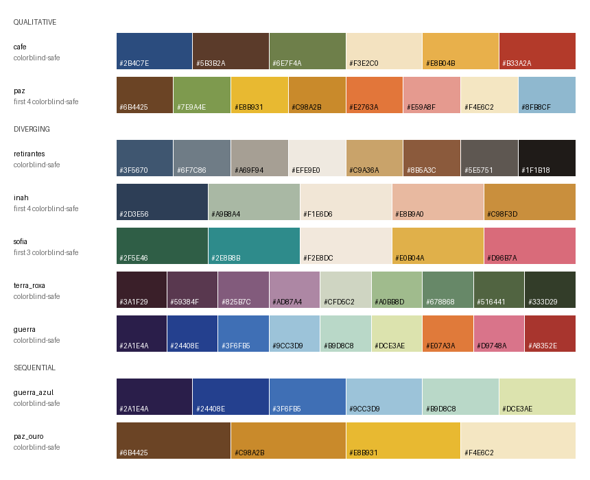

# PortinariColors 

<!-- badges: start -->
[](https://github.com/rafalopespx/PortinariColors/actions/workflows/R-CMD-check.yaml)
<!-- badges: end -->

Color palettes inspired by paintings of [Candido Portinari](https://en.wikipedia.org/wiki/Candido_Portinari) in the Museu de Arte
de Sao Paulo (MASP) collection and by his *Guerra* and *Paz* panels at the
United Nations Headquarters in New York. Fast to use, easy to plot with, and built for
[`ggplot2`](https://ggplot2.tidyverse.org/).

<!--  -->

## Installation

```r
# install.packages("remotes")
remotes::install_github("rafalopespx/PortinariColors")
```

## Quick start

```r
library(PortinariColors)
library(ggplot2)

portinari.pal("cafe")                         # full palette as hex codes
portinari.pal("retirantes", n = 3)            # 3 colors: both ends and the center
portinari.pal("guerra_azul", n = 20, type = "continuous")  # interpolated

# Qualitative: unordered groups
ggplot(mtcars, aes(wt, mpg, colour = factor(cyl))) +
  geom_point(size = 3) +
  scale_color_portinari("cafe", name = "Cylinders")

# Sequential: ordered values
ggplot(faithfuld, aes(waiting, eruptions, fill = density)) +
  geom_raster() +
  scale_fill_portinari("guerra_azul", type = "continuous", direction = -1)

# Diverging: values around a midpoint
ggplot(mtcars, aes(wt, mpg, colour = mpg - mean(mpg))) +
  geom_point(size = 3) +
  scale_color_portinari("guerra", type = "continuous")
```

Discrete palettes pick colors to suit the palette style: the most distinct
colors for qualitative palettes, evenly spaced steps for sequential palettes,
and balanced steps either side of the light center for diverging palettes.
Continuous palettes interpolate the full palette in CIELAB.

## Main functions

| Function | Purpose |
| --- | --- |
| `portinari.pal()` | Get a palette as hex colors (discrete or continuous) |
| `scale_color_portinari()` / `scale_colour_portinari()` | `ggplot2` color scale |
| `scale_fill_portinari()` | `ggplot2` fill scale |
| `portinari.palettes()` | Table of palettes by style, with colorblind status |
| `portinari.works()` | The paintings behind each palette, with links |
| `portinari.cvd.check()` | Colorblind simulation for a palette |
| `show_portinari()` | Draw palettes as swatches |

`portinari.pal()` and the scale functions share the same arguments:
`type = "discrete" | "continuous"`, `direction = 1 | -1`, and
`colorblind = TRUE | FALSE`.

## Palettes

| Palette | Style | Colors | Colorblind-safe | Works |
| --- | --- | --- | --- | --- |
| `cafe` | qualitative | 6 | all 6 | Coffee Agricultural Worker; Saint Francis |
| `paz` | qualitative | 8 | 4 | *Paz* (Peace), UN Headquarters panel |
| `retirantes` | diverging | 8 | all 8 | Northeastern Migrants; Dead Child; Bust of the Poet Felippe d'Oliveira; Mr. Queiroz Lima |
| `inah` | diverging | 5 | 4 | Portrait of Ináh Prudente de Moraes |
| `sofia` | diverging | 5 | 3 | Portrait of Sofia Cantalupo |
| `guerra` | diverging | 9 | all 9 | *Guerra* (War), UN Headquarters panel |
| `guerra_azul` | sequential | 6 | all 6 | Blue scale of *Guerra* |
| `paz_ouro` | sequential | 4 | all 4 | Earth-to-gold run of *Paz* |

See [The paintings](https://rafalopespx.github.io/PortinariColors/articles/paintings.html)
for images and links to every work, and
[Choosing a palette style](https://rafalopespx.github.io/PortinariColors/articles/palette-styles.html)
for when to use each style.

Palettes are merged when they are too similar. Candidate palettes were
compared by mean CIELAB distance. Two groups were merged this way:
the migrant-series works with the 'Felippe d'Oliveira bust' and the 'Queiroz Lima'
portrait, and the 'Coffee Agricultural Worker' with 'Saint Francis'. `guerra` and
`paz` are distinct from every other palette (closest: `paz` vs `cafe`, dE 18.9),
so they stay separate. `guerra_azul` and `paz_ouro` are sequential subsets of
the two panels and are kept on purpose: they serve a different kind of data
rather than duplicating a palette.

Use `colorblind = TRUE` to keep only the colorblind-safe colors of a palette:

```r
portinari.pal("inah", colorblind = TRUE)      # 4 safe colors
portinari.cvd.check("sofia")                  # see where the palette breaks down
```

## Important: colors are estimates

The hex values are hand-estimated from the dominant tones of each painting.
They were **not** sampled from the MASP images. `guerra` and `paz` follow
published descriptions of the panels: *Guerra* as "a symphony in blue" of deep
violet tones over light blues tending to pale citrine, with an orange-to-red
counterpoint, and *Paz* as dominated by golden yellows. Treat them as a starting point.
`data-raw/extract_masp_palettes.R` samples the originals when the MASP site is
reachable, and `data-raw/palette_selection.py` reproduces the merge and
colorblind analysis.

## Colorblind safety

A palette is colorblind-safe for its first `n` colors when those colors stay
at least CIE76 dE 10 apart under protanopia, deuteranopia and tritanopia
simulation [Machado et al., 2009](https://ieeexplore.ieee.org/stamp/stamp.jsp?tp=&arnumber=5290741). The simulation is in `portinari.cvd.check()`.

## Contributing

Add a palette by appending an entry to `.portinari_palettes` in
`R/palettes.R`. Order the colors by priority, then set `cvd_n` by running
`portinari.cvd.check()` on the new palette.

## Credits

Works by Candido Portinari (1903-1962). Images and metadata are from the
Museu de Arte de Sao Paulo (MASP) collection. The palettes are an inspired
interpretation, not an official MASP product.

The package API follows the conventions of [`MoMAColors`](https://github.com/BlakeRMills/MoMAColors) and [`MetBrewer`](https://github.com/BlakeRMills/MetBrewer).
