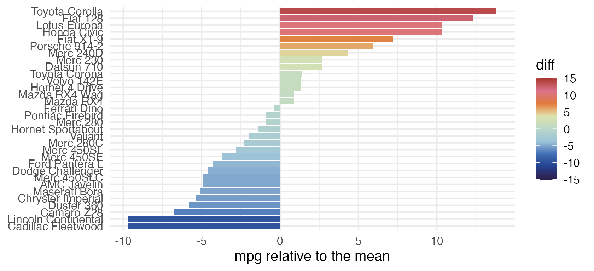
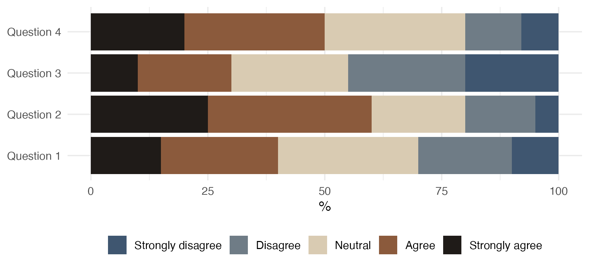
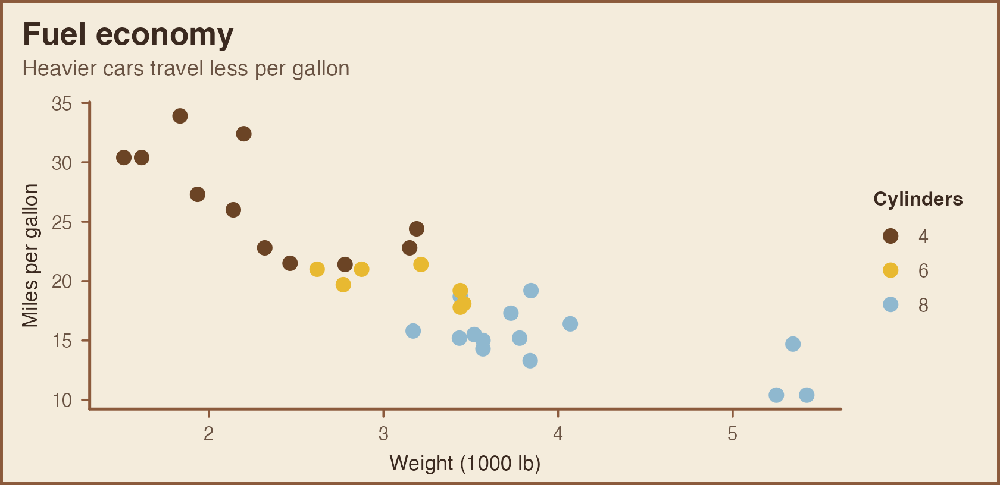
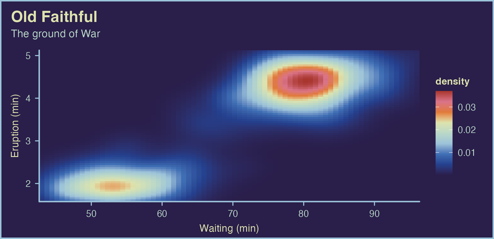
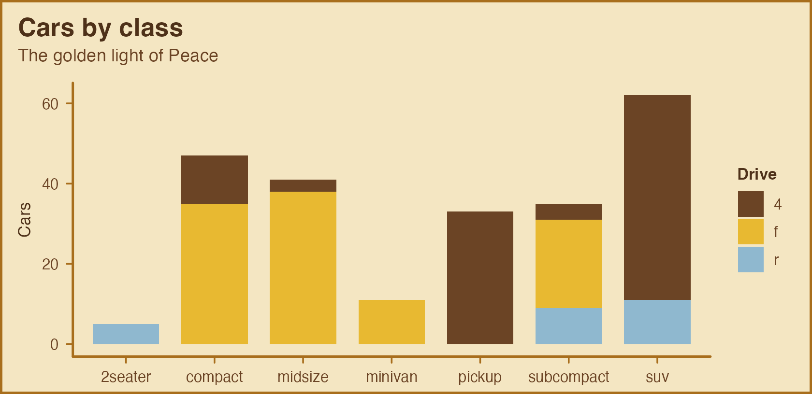

# Choosing a palette style

Like RColorBrewer and MetBrewer, PortinariColors groups its palettes by
the kind of data they suit.

\
[`portinari.palettes`](https://rafalopespx.github.io/PortinariColors/reference/portinari.palettes.md)`(``)``[``, `[`c`](https://rdrr.io/r/base/c.html)`(``"palette"``, ``"category"``, ``"n_colors"``, ``"cvd_n"``)``]`

    ##        palette    category n_colors cvd_n
    ## 1         cafe qualitative        6     6
    ## 2          paz qualitative        8     4
    ## 3   retirantes   diverging        8     8
    ## 4         inah   diverging        5     4
    ## 5        sofia   diverging        5     3
    ## 6   terra_roxa   diverging        9     9
    ## 7       guerra   diverging        9     9
    ## 8  guerra_azul  sequential        6     6
    ## 9   roxa_terra  sequential        8     8
    ## 10    paz_ouro  sequential        4     4

## Qualitative: unordered groups

Distinct hues with no implied order. Asking for `n` colors returns the
`n` most distinct ones.

\
[`show_portinari`](https://rafalopespx.github.io/PortinariColors/reference/show_portinari.md)`(``category ``=`` ``"qualitative"``)`

\
[`ggplot`](https://ggplot2.tidyverse.org/reference/ggplot.html)`(``mpg``, `[`aes`](https://ggplot2.tidyverse.org/reference/aes.html)`(``displ``, ``hwy``, colour ``=`` ``drv``)``)`` ``+`\
`  `[`geom_point`](https://ggplot2.tidyverse.org/reference/geom_point.html)`(``size ``=`` ``2.5``, alpha ``=`` ``0.8``)`` ``+`\
`  `[`scale_color_portinari`](https://rafalopespx.github.io/PortinariColors/reference/portinari_scales.md)`(``"cafe"``, name ``=`` ``"Drive"``)`

## Sequential: ordered values

Colors run from dark to light. Discrete subsets keep both ends and space
the rest evenly.

\
[`show_portinari`](https://rafalopespx.github.io/PortinariColors/reference/show_portinari.md)`(``category ``=`` ``"sequential"``)`

\
[`ggplot`](https://ggplot2.tidyverse.org/reference/ggplot.html)`(``faithfuld``, `[`aes`](https://ggplot2.tidyverse.org/reference/aes.html)`(``waiting``, ``eruptions``, fill ``=`` ``density``)``)`` ``+`\
`  `[`geom_raster`](https://ggplot2.tidyverse.org/reference/geom_tile.html)`(``)`` ``+`\
`  `[`scale_fill_portinari`](https://rafalopespx.github.io/PortinariColors/reference/portinari_scales.md)`(``"guerra_azul"``, type ``=`` ``"continuous"``, direction ``=`` ``-``1``)`` ``+`\
`  `[`coord_cartesian`](https://ggplot2.tidyverse.org/reference/coord_cartesian.html)`(``expand ``=`` ``FALSE``)`

`roxa_terra` runs from the soil black of *Coffee Agricultural Worker*
through its plums to the pale citrine of *Guerra*, the lightest color of
`guerra_azul`, so even its lightest values stay visible on a white page.
Here it maps the elevation of Maungawhau volcano.

\
`volcano_long`` ``<-`` `[`data.frame`](https://rdrr.io/r/base/data.frame.html)`(`\
`  x ``=`` `[`rep`](https://rdrr.io/r/base/rep.html)`(`[`seq_len`](https://rdrr.io/r/base/seq.html)`(`[`nrow`](https://rdrr.io/r/base/nrow.html)`(``volcano``)``)``, `[`ncol`](https://rdrr.io/r/base/nrow.html)`(``volcano``)``)``,`\
`  y ``=`` `[`rep`](https://rdrr.io/r/base/rep.html)`(`[`seq_len`](https://rdrr.io/r/base/seq.html)`(`[`ncol`](https://rdrr.io/r/base/nrow.html)`(``volcano``)``)``, each ``=`` `[`nrow`](https://rdrr.io/r/base/nrow.html)`(``volcano``)``)``,`\
`  height ``=`` `[`as.vector`](https://rdrr.io/r/base/vector.html)`(``volcano``)`\
`)`\
[`ggplot`](https://ggplot2.tidyverse.org/reference/ggplot.html)`(``volcano_long``, `[`aes`](https://ggplot2.tidyverse.org/reference/aes.html)`(``x``, ``y``, fill ``=`` ``height``)``)`` ``+`\
`  `[`geom_raster`](https://ggplot2.tidyverse.org/reference/geom_tile.html)`(``)`` ``+`\
`  `[`scale_fill_portinari`](https://rafalopespx.github.io/PortinariColors/reference/portinari_scales.md)`(``"roxa_terra"``, type ``=`` ``"continuous"``, direction ``=`` ``-``1``,`\
`                       name ``=`` ``"Height (m)"``)`` ``+`\
`  `[`coord_equal`](https://ggplot2.tidyverse.org/reference/coord_fixed.html)`(``expand ``=`` ``FALSE``)`` ``+`\
`  `[`labs`](https://ggplot2.tidyverse.org/reference/labs.html)`(``x ``=`` ``NULL``, y ``=`` ``NULL``)`` ``+`\
`  `[`theme`](https://ggplot2.tidyverse.org/reference/theme.html)`(``axis.text ``=`` `[`element_blank`](https://ggplot2.tidyverse.org/reference/element.html)`(``)``)`

## Diverging: values around a midpoint

Two dark arms meet in a light center, so the middle of the scale reads
as neutral. Discrete subsets take both ends, then the center, then fill
each arm evenly.

\
[`show_portinari`](https://rafalopespx.github.io/PortinariColors/reference/show_portinari.md)`(``category ``=`` ``"diverging"``)`

`terra_roxa` sets the plum of a coffee worker’s shirt against the green
of the plantation behind him, a classic purple-green diverging scheme.
It is colorblind-safe for all nine colors, which makes it a good default
for correlation matrices.

\
`cors`` ``<-`` `[`cor`](https://rdrr.io/r/stats/cor.html)`(``mtcars``)`\
`cors_long`` ``<-`` `[`data.frame`](https://rdrr.io/r/base/data.frame.html)`(`\
`  x ``=`` `[`factor`](https://rdrr.io/r/base/factor.html)`(`[`rep`](https://rdrr.io/r/base/rep.html)`(`[`colnames`](https://rdrr.io/r/base/colnames.html)`(``cors``)``, each ``=`` `[`ncol`](https://rdrr.io/r/base/nrow.html)`(``cors``)``)``, levels ``=`` `[`colnames`](https://rdrr.io/r/base/colnames.html)`(``cors``)``)``,`\
`  y ``=`` `[`factor`](https://rdrr.io/r/base/factor.html)`(`[`rep`](https://rdrr.io/r/base/rep.html)`(`[`colnames`](https://rdrr.io/r/base/colnames.html)`(``cors``)``, times ``=`` `[`ncol`](https://rdrr.io/r/base/nrow.html)`(``cors``)``)``, levels ``=`` `[`rev`](https://rdrr.io/r/base/rev.html)`(`[`colnames`](https://rdrr.io/r/base/colnames.html)`(``cors``)``)``)``,`\
`  r ``=`` `[`as.vector`](https://rdrr.io/r/base/vector.html)`(``cors``)`\
`)`\
[`ggplot`](https://ggplot2.tidyverse.org/reference/ggplot.html)`(``cors_long``, `[`aes`](https://ggplot2.tidyverse.org/reference/aes.html)`(``x``, ``y``, fill ``=`` ``r``)``)`` ``+`\
`  `[`geom_tile`](https://ggplot2.tidyverse.org/reference/geom_tile.html)`(``colour ``=`` ``"white"``, linewidth ``=`` ``0.6``)`` ``+`\
`  `[`geom_text`](https://ggplot2.tidyverse.org/reference/geom_text.html)`(`[`aes`](https://ggplot2.tidyverse.org/reference/aes.html)`(``label ``=`` `[`sprintf`](https://rdrr.io/r/base/sprintf.html)`(``"%.1f"``, ``r``)``)``, size ``=`` ``2.8``,`\
`            colour ``=`` `[`ifelse`](https://rdrr.io/r/base/ifelse.html)`(``cors_long``$``r`` ``<`` ``-``0.3`` ``|`` ``cors_long``$``r`` ``>`` ``0.55``, ``"white"``, ``"grey15"``)``)`` ``+`\
`  `[`scale_fill_portinari`](https://rafalopespx.github.io/PortinariColors/reference/portinari_scales.md)`(``"terra_roxa"``, type ``=`` ``"continuous"``, limits ``=`` `[`c`](https://rdrr.io/r/base/c.html)`(``-``1``, ``1``)``,`\
`                       name ``=`` ``"Correlation"``)`` ``+`\
`  `[`coord_equal`](https://ggplot2.tidyverse.org/reference/coord_fixed.html)`(``)`` ``+`\
`  `[`labs`](https://ggplot2.tidyverse.org/reference/labs.html)`(``x ``=`` ``NULL``, y ``=`` ``NULL``)`` ``+`\
`  `[`theme`](https://ggplot2.tidyverse.org/reference/theme.html)`(``panel.grid ``=`` `[`element_blank`](https://ggplot2.tidyverse.org/reference/element.html)`(``)``)`

\
`cars`` ``<-`` `[`transform`](https://rdrr.io/r/base/transform.html)`(``mtcars``, car ``=`` `[`rownames`](https://rdrr.io/r/base/colnames.html)`(``mtcars``)``, diff ``=`` ``mpg`` ``-`` `[`mean`](https://rdrr.io/r/base/mean.html)`(``mpg``)``)`\
[`ggplot`](https://ggplot2.tidyverse.org/reference/ggplot.html)`(``cars``, `[`aes`](https://ggplot2.tidyverse.org/reference/aes.html)`(``diff``, `[`reorder`](https://rdrr.io/r/stats/reorder.factor.html)`(``car``, ``diff``)``, fill ``=`` ``diff``)``)`` ``+`\
`  `[`geom_col`](https://ggplot2.tidyverse.org/reference/geom_bar.html)`(``)`` ``+`\
`  `[`scale_fill_portinari`](https://rafalopespx.github.io/PortinariColors/reference/portinari_scales.md)`(``"guerra"``, type ``=`` ``"continuous"``, limits ``=`` `[`c`](https://rdrr.io/r/base/c.html)`(``-``15``, ``15``)``)`` ``+`\
`  `[`labs`](https://ggplot2.tidyverse.org/reference/labs.html)`(``x ``=`` ``"mpg relative to the mean"``, y ``=`` ``NULL``)`

\
`likert`` ``<-`` `[`data.frame`](https://rdrr.io/r/base/data.frame.html)`(`\
`  question ``=`` `[`rep`](https://rdrr.io/r/base/rep.html)`(`[`paste`](https://rdrr.io/r/base/paste.html)`(``"Question"``, ``1``:``4``)``, each ``=`` ``5``)``,`\
`  answer ``=`` `[`factor`](https://rdrr.io/r/base/factor.html)`(`[`rep`](https://rdrr.io/r/base/rep.html)`(`[`c`](https://rdrr.io/r/base/c.html)`(``"Strongly disagree"``, ``"Disagree"``, ``"Neutral"``, ``"Agree"``, ``"Strongly agree"``)``, ``4``)``,`\
`                  levels ``=`` `[`c`](https://rdrr.io/r/base/c.html)`(``"Strongly disagree"``, ``"Disagree"``, ``"Neutral"``, ``"Agree"``, ``"Strongly agree"``)``)``,`\
`  share ``=`` `[`c`](https://rdrr.io/r/base/c.html)`(``10``, ``20``, ``30``, ``25``, ``15``, ``5``, ``15``, ``20``, ``35``, ``25``, ``20``, ``25``, ``25``, ``20``, ``10``, ``8``, ``12``, ``30``, ``30``, ``20``)`\
`)`\
[`ggplot`](https://ggplot2.tidyverse.org/reference/ggplot.html)`(``likert``, `[`aes`](https://ggplot2.tidyverse.org/reference/aes.html)`(``share``, ``question``, fill ``=`` ``answer``)``)`` ``+`\
`  `[`geom_col`](https://ggplot2.tidyverse.org/reference/geom_bar.html)`(``)`` ``+`\
`  `[`scale_fill_portinari`](https://rafalopespx.github.io/PortinariColors/reference/portinari_scales.md)`(``"retirantes"``, name ``=`` ``NULL``)`` ``+`\
`  `[`labs`](https://ggplot2.tidyverse.org/reference/labs.html)`(``x ``=`` ``"%"``, y ``=`` ``NULL``)`` ``+`\
`  `[`theme`](https://ggplot2.tidyverse.org/reference/theme.html)`(``legend.position ``=`` ``"bottom"``)`

## A Portinari canvas for your plots

[`theme_portinari()`](https://rafalopespx.github.io/PortinariColors/reference/theme_portinari.md)
completes the look: a raw-linen ground, firm drawn axis lines,
earth-colored lettering and a painted frame. The `guerra` and `paz`
moods follow the two United Nations panels.

\
[`ggplot`](https://ggplot2.tidyverse.org/reference/ggplot.html)`(``mtcars``, `[`aes`](https://ggplot2.tidyverse.org/reference/aes.html)`(``wt``, ``mpg``, colour ``=`` `[`factor`](https://rdrr.io/r/base/factor.html)`(``cyl``)``)``)`` ``+`\
`  `[`geom_point`](https://ggplot2.tidyverse.org/reference/geom_point.html)`(``size ``=`` ``3``)`` ``+`\
`  `[`scale_color_portinari`](https://rafalopespx.github.io/PortinariColors/reference/portinari_scales.md)`(``"paz"``, name ``=`` ``"Cylinders"``)`` ``+`\
`  `[`labs`](https://ggplot2.tidyverse.org/reference/labs.html)`(``title ``=`` ``"Fuel economy"``, subtitle ``=`` ``"Heavier cars travel less per gallon"``,`\
`       x ``=`` ``"Weight (1000 lb)"``, y ``=`` ``"Miles per gallon"``)`` ``+`\
`  `[`theme_portinari`](https://rafalopespx.github.io/PortinariColors/reference/theme_portinari.md)`(``)`

\
[`ggplot`](https://ggplot2.tidyverse.org/reference/ggplot.html)`(``faithfuld``, `[`aes`](https://ggplot2.tidyverse.org/reference/aes.html)`(``waiting``, ``eruptions``, fill ``=`` ``density``)``)`` ``+`\
`  `[`geom_raster`](https://ggplot2.tidyverse.org/reference/geom_tile.html)`(``)`` ``+`\
`  `[`scale_fill_portinari`](https://rafalopespx.github.io/PortinariColors/reference/portinari_scales.md)`(``"guerra"``, type ``=`` ``"continuous"``)`` ``+`\
`  `[`coord_cartesian`](https://ggplot2.tidyverse.org/reference/coord_cartesian.html)`(``expand ``=`` ``FALSE``)`` ``+`\
`  `[`labs`](https://ggplot2.tidyverse.org/reference/labs.html)`(``title ``=`` ``"Old Faithful"``, subtitle ``=`` ``"The ground of War"``,`\
`       x ``=`` ``"Waiting (min)"``, y ``=`` ``"Eruption (min)"``)`` ``+`\
`  `[`theme_portinari`](https://rafalopespx.github.io/PortinariColors/reference/theme_portinari.md)`(``"guerra"``, grid ``=`` ``"none"``)`

\
[`ggplot`](https://ggplot2.tidyverse.org/reference/ggplot.html)`(``mpg``, `[`aes`](https://ggplot2.tidyverse.org/reference/aes.html)`(``class``, fill ``=`` ``drv``)``)`` ``+`\
`  `[`geom_bar`](https://ggplot2.tidyverse.org/reference/geom_bar.html)`(``width ``=`` ``0.75``)`` ``+`\
`  `[`scale_fill_portinari`](https://rafalopespx.github.io/PortinariColors/reference/portinari_scales.md)`(``"paz"``, name ``=`` ``"Drive"``)`` ``+`\
`  `[`labs`](https://ggplot2.tidyverse.org/reference/labs.html)`(``title ``=`` ``"Cars by class"``, subtitle ``=`` ``"The golden light of Peace"``,`\
`       x ``=`` ``NULL``, y ``=`` ``"Cars"``)`` ``+`\
`  `[`theme_portinari`](https://rafalopespx.github.io/PortinariColors/reference/theme_portinari.md)`(``"paz"``)`

On a light mood, a palette’s lightest color sits close to the ground:
that suits filled areas, where it reads as neutral, but not points or
lines. On the `guerra` mood, prefer palettes other than `guerra` and
`guerra_azul`, whose darkest color is the ground itself.

## Colorblind safety

`colorblind = TRUE` restricts any palette to colors that stay distinct
under protanopia, deuteranopia and tritanopia simulation.

\
[`portinari.pal`](https://rafalopespx.github.io/PortinariColors/reference/portinari.pal.md)`(``"sofia"``, colorblind ``=`` ``TRUE``)`

    ## <Portinari palette 'sofia'> 3 colors
    ## [1] "#2F5E46" "#F2E8DC" "#D96B7A"

\
[`portinari.cvd.check`](https://rafalopespx.github.io/PortinariColors/reference/portinari.cvd.check.md)`(``"sofia"``)`

    ##   n   normal protanopia deuteranopia tritanopia colorblind_safe
    ## 1 2 70.64010  18.331205     28.30175   82.36919            TRUE
    ## 2 3 55.02795  18.331205     28.30175   62.42223            TRUE
    ## 3 4 24.12647   7.530853     23.95855   21.86508           FALSE
    ## 4 5 24.12647   7.530853     23.95855   21.86508           FALSE
