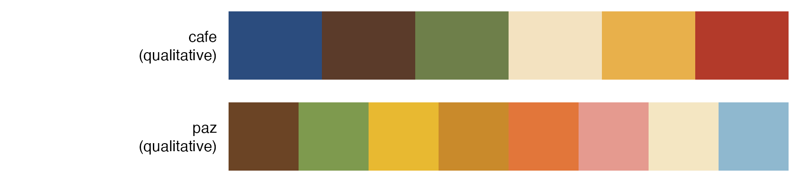
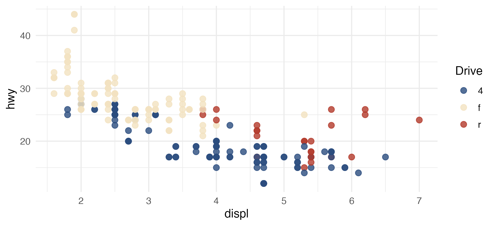
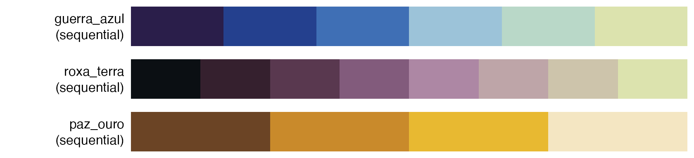
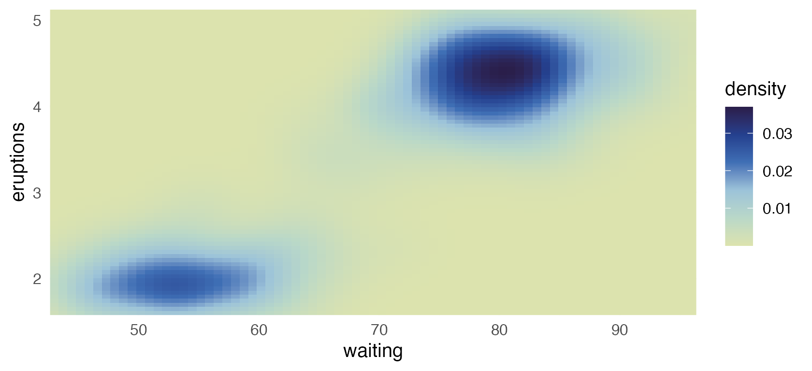
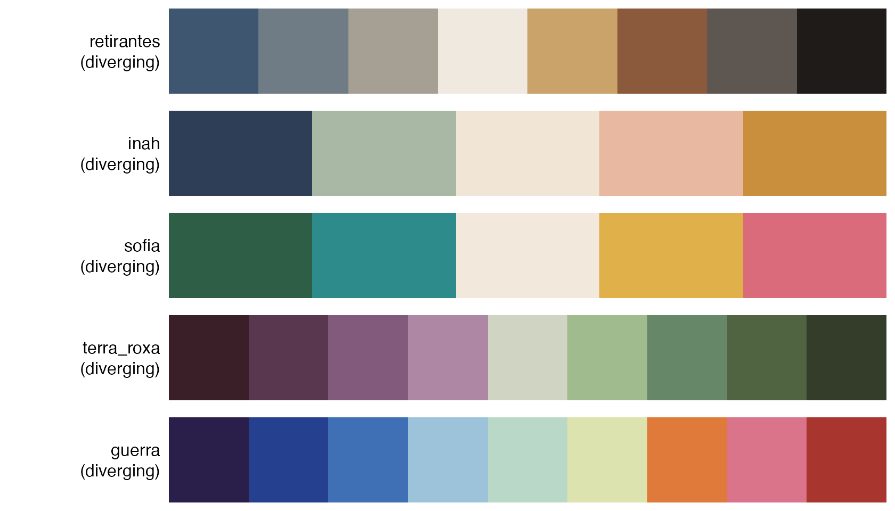
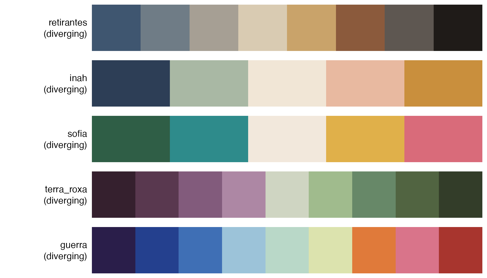
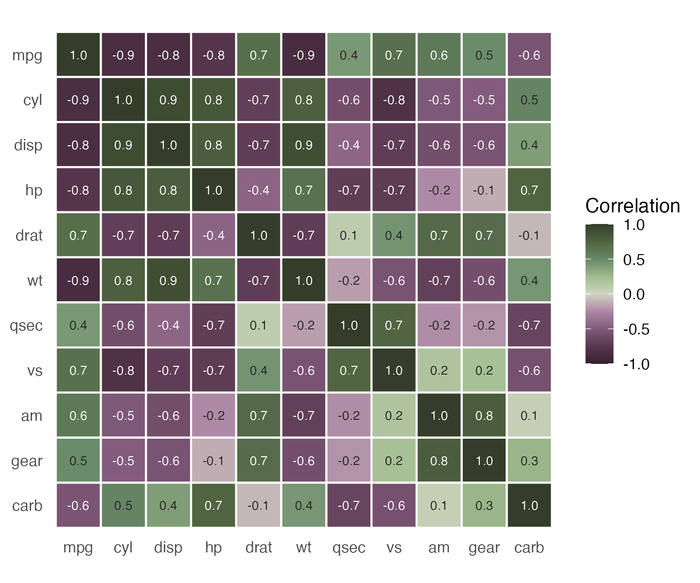

# Choosing a palette style

Like RColorBrewer and MetBrewer, PortinariColors groups its palettes by
the kind of data they suit.

\
[`portinari.palettes`](https://rafalopespx.github.io/PortinariColors/reference/portinari.palettes.md)`(``)``[``, `[`c`](https://rdrr.io/r/base/c.html)`(``"palette"``, ``"category"``, ``"n_colors"``, ``"cvd_n"``)``]`

    ##       palette    category n_colors cvd_n
    ## 1        cafe qualitative        6     6
    ## 2         paz qualitative        8     4
    ## 3  retirantes   diverging        8     8
    ## 4        inah   diverging        5     4
    ## 5       sofia   diverging        5     3
    ## 6      guerra   diverging        9     9
    ## 7 guerra_azul  sequential        6     6
    ## 8    paz_ouro  sequential        4     4

## Qualitative: unordered groups

Distinct hues with no implied order. Asking for `n` colors returns the
`n` most distinct ones.

\
[`show_portinari`](https://rafalopespx.github.io/PortinariColors/reference/show_portinari.md)`(``category ``=`` ``"qualitative"``)`

\
[`ggplot`](https://ggplot2.tidyverse.org/reference/ggplot.html)`(``mpg``, `[`aes`](https://ggplot2.tidyverse.org/reference/aes.html)`(``displ``, ``hwy``, colour ``=`` ``drv``)``)`` ``+`\
`  `[`geom_point`](https://ggplot2.tidyverse.org/reference/geom_point.html)`(``size ``=`` ``2.5``, alpha ``=`` ``0.8``)`` ``+`\
`  `[`scale_color_portinari`](https://rafalopespx.github.io/PortinariColors/reference/portinari_scales.md)`(``"cafe"``, name ``=`` ``"Drive"``)`

## Sequential: ordered values

Colors run from dark to light. Discrete subsets keep both ends and space
the rest evenly.

\
[`show_portinari`](https://rafalopespx.github.io/PortinariColors/reference/show_portinari.md)`(``category ``=`` ``"sequential"``)`

\
[`ggplot`](https://ggplot2.tidyverse.org/reference/ggplot.html)`(``faithfuld``, `[`aes`](https://ggplot2.tidyverse.org/reference/aes.html)`(``waiting``, ``eruptions``, fill ``=`` ``density``)``)`` ``+`\
`  `[`geom_raster`](https://ggplot2.tidyverse.org/reference/geom_tile.html)`(``)`` ``+`\
`  `[`scale_fill_portinari`](https://rafalopespx.github.io/PortinariColors/reference/portinari_scales.md)`(``"guerra_azul"``, type ``=`` ``"continuous"``, direction ``=`` ``-``1``)`` ``+`\
`  `[`coord_cartesian`](https://ggplot2.tidyverse.org/reference/coord_cartesian.html)`(``expand ``=`` ``FALSE``)`

## Diverging: values around a midpoint

Two dark arms meet in a light center, so the middle of the scale reads
as neutral. Discrete subsets take both ends, then the center, then fill
each arm evenly.

\
[`show_portinari`](https://rafalopespx.github.io/PortinariColors/reference/show_portinari.md)`(``category ``=`` ``"diverging"``)`

\
`cars`` ``<-`` `[`transform`](https://rdrr.io/r/base/transform.html)`(``mtcars``, car ``=`` `[`rownames`](https://rdrr.io/r/base/colnames.html)`(``mtcars``)``, diff ``=`` ``mpg`` ``-`` `[`mean`](https://rdrr.io/r/base/mean.html)`(``mpg``)``)`\
[`ggplot`](https://ggplot2.tidyverse.org/reference/ggplot.html)`(``cars``, `[`aes`](https://ggplot2.tidyverse.org/reference/aes.html)`(``diff``, `[`reorder`](https://rdrr.io/r/stats/reorder.factor.html)`(``car``, ``diff``)``, fill ``=`` ``diff``)``)`` ``+`\
`  `[`geom_col`](https://ggplot2.tidyverse.org/reference/geom_bar.html)`(``)`` ``+`\
`  `[`scale_fill_portinari`](https://rafalopespx.github.io/PortinariColors/reference/portinari_scales.md)`(``"guerra"``, type ``=`` ``"continuous"``, limits ``=`` `[`c`](https://rdrr.io/r/base/c.html)`(``-``15``, ``15``)``)`` ``+`\
`  `[`labs`](https://ggplot2.tidyverse.org/reference/labs.html)`(``x ``=`` ``"mpg relative to the mean"``, y ``=`` ``NULL``)`

\
`likert`` ``<-`` `[`data.frame`](https://rdrr.io/r/base/data.frame.html)`(`\
`  question ``=`` `[`rep`](https://rdrr.io/r/base/rep.html)`(`[`paste`](https://rdrr.io/r/base/paste.html)`(``"Question"``, ``1``:``4``)``, each ``=`` ``5``)``,`\
`  answer ``=`` `[`factor`](https://rdrr.io/r/base/factor.html)`(`[`rep`](https://rdrr.io/r/base/rep.html)`(`[`c`](https://rdrr.io/r/base/c.html)`(``"Strongly disagree"``, ``"Disagree"``, ``"Neutral"``, ``"Agree"``, ``"Strongly agree"``)``, ``4``)``,`\
`                  levels ``=`` `[`c`](https://rdrr.io/r/base/c.html)`(``"Strongly disagree"``, ``"Disagree"``, ``"Neutral"``, ``"Agree"``, ``"Strongly agree"``)``)``,`\
`  share ``=`` `[`c`](https://rdrr.io/r/base/c.html)`(``10``, ``20``, ``30``, ``25``, ``15``, ``5``, ``15``, ``20``, ``35``, ``25``, ``20``, ``25``, ``25``, ``20``, ``10``, ``8``, ``12``, ``30``, ``30``, ``20``)`\
`)`\
[`ggplot`](https://ggplot2.tidyverse.org/reference/ggplot.html)`(``likert``, `[`aes`](https://ggplot2.tidyverse.org/reference/aes.html)`(``share``, ``question``, fill ``=`` ``answer``)``)`` ``+`\
`  `[`geom_col`](https://ggplot2.tidyverse.org/reference/geom_bar.html)`(``)`` ``+`\
`  `[`scale_fill_portinari`](https://rafalopespx.github.io/PortinariColors/reference/portinari_scales.md)`(``"retirantes"``, name ``=`` ``NULL``)`` ``+`\
`  `[`labs`](https://ggplot2.tidyverse.org/reference/labs.html)`(``x ``=`` ``"%"``, y ``=`` ``NULL``)`` ``+`\
`  `[`theme`](https://ggplot2.tidyverse.org/reference/theme.html)`(``legend.position ``=`` ``"bottom"``)`

## Colorblind safety

`colorblind = TRUE` restricts any palette to colors that stay distinct
under protanopia, deuteranopia and tritanopia simulation.

\
[`portinari.pal`](https://rafalopespx.github.io/PortinariColors/reference/portinari.pal.md)`(``"sofia"``, colorblind ``=`` ``TRUE``)`

    ## <Portinari palette 'sofia'> 3 colors
    ## [1] "#2F5E46" "#F2E8DC" "#D96B7A"

\
[`portinari.cvd.check`](https://rafalopespx.github.io/PortinariColors/reference/portinari.cvd.check.md)`(``"sofia"``)`

    ##   n   normal protanopia deuteranopia tritanopia colorblind_safe
    ## 1 2 70.64010  18.331205     28.30175   82.36919            TRUE
    ## 2 3 55.02795  18.331205     28.30175   62.42223            TRUE
    ## 3 4 24.12647   7.530853     23.95855   21.86508           FALSE
    ## 4 5 24.12647   7.530853     23.95855   21.86508           FALSE
